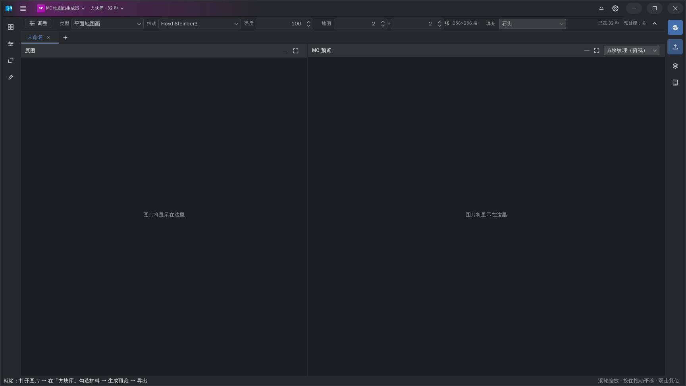

# MC Pixel Art Converter (MCART)

English | [简体中文](./README_zh_CN.md)

A desktop application that converts images into Minecraft pixel art. The application quantizes the image, matches colors from a selected set of blocks, and produces a flat or height-based block layout that can be exported as structure files, commands, or data packs for use in the game.

The graphical interface is built with Java Swing, using the FlatLaf look and feel and MigLayout. The core logic is implemented in a mix of Java and Kotlin and built with Gradle. In addition to the graphical interface, a headless command-line mode is available.



## Repository Layout

The repository is organized into two directories: the original Java version and a version adapted for native image. Their source code is not identical.

| Directory | Contents | Purpose |
|---|---|---|
| `jar/` | The original Java and Kotlin source with Gradle build scripts, without native adaptations or native build files | Build a runnable fat jar |
| `native-build/` | Adds native-adaptation code to the original version, along with native image configuration, metadata, a collector, and resources | Build native executables for each platform; CI runs in this directory |

The source in `native-build/` contains adjustments required for GraalVM native image (such as working around missing JNI/reflection access in some internal classes, and adding run-time self-healing and an in-app splash screen), while keeping the core functionality and UI consistent.

Native build-related directories inside `native-build/`:

- `native-config/`: Platform-independent GraalVM configuration baseline for reflection, resources, and other settings.
- `linux-trace/`: Runtime metadata collected on Linux through the tracing agent.
- `native-resources/`: The fontconfig binary and executable manifest used on Windows.
- `tools/NativeMetadataCollector.java`: A metadata collector that runs under the GraalVM JVM and uses the agent to collect runtime information such as reflection, JNI, and resources.

## Features

- Two generation modes: flat (all blocks at the same height) and relief (stepped heights generated from the image, with shading expressed through block height differences).
- Multiple dithering methods: none, blue noise, Floyd-Steinberg, Burkes, Atkinson, Stucki, Jarvis, Sierra, and ordered dithering; dithering strength is adjustable.
- Image preprocessing: brightness, contrast, gamma, channel gain, saturation, color quantization, background handling, and crop region selection.
- Block library: browse and search by category, with tag filtering, presets, and custom blocks.
- Preview: four views covering block textures, map colors, a relief model, and color gamut warnings, with zoom and pan support.
- Project management: multiple tabs, undo and redo, project file saving, session recovery, and snapshot comparison.
- Export formats: `.litematic`, `.schem`, `.schematic`, `.nbt`, `.mcfunction`, data pack `.zip`, bill of materials `.csv`, and preview image `.png`.
- Batch processing and command-line mode.
- Three themes (dark, light, and high contrast) and Chinese/English interfaces.

## Building

### Building the Fat Jar

JDK 17 is required.

```bash
cd jar
./gradlew jar
```

The output is placed under `build/libs/` and can be run with `java -jar <jar file>`.

### Building Native Executables

Native images are generated with GraalVM native-image. The corresponding workflow is located at `.github/workflows/native-build.yml` and runs on push or manual trigger. It contains two parallel jobs:

- `build-windows`: builds on `windows-latest`, including font configuration, GUI subsystem settings (no console window), and native library compression.
- `build-linux`: builds on `ubuntu-latest`, obtaining fonts through the system fontconfig without bundling font files.

The build outputs from both jobs are provided as Actions artifacts.

Building native executables locally requires GraalVM 25 with the native-image component. native-image does not support cross-compilation, so a platform's executable must be built on that operating system. The Linux runtime environment needs fontconfig; the linker options and font files used for Windows builds apply only to Windows.

## Command-Line Mode

```bash
java -jar <jar file> --cli \
  --input image.png --output output.litematic \
  --mode flat --dither BLUE_NOISE --strength 80 \
  --maps 2x2 --blocks default --support stone
```

Use `--help` to view all parameters.

## Data Directory

Configuration, presets, projects, and logs generated at runtime are stored by default in a `mc-pixel-art-data/` directory next to the executable rather than in the user's home directory. The location can be changed with the startup option `-Dmcart.home=path`.

## Stack and Versions

- Java 17, Kotlin 2.0.20
- Gradle 8.x, FlatLaf 3.7.1, MigLayout 3.7.4
- GraalVM 25.0.2 (native-image)
